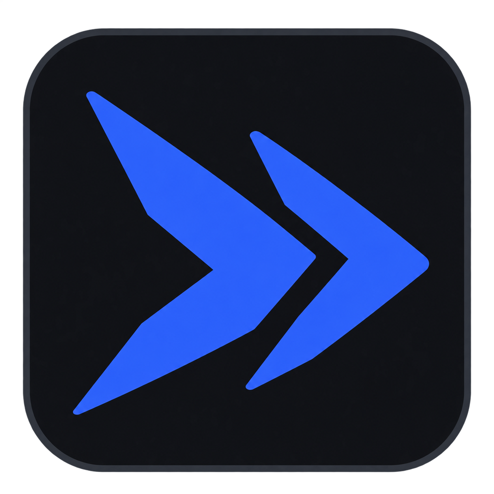

  

  # BlueAsh

  **Focus on the game. Let BlueAsh handle the little things.**

  A free, open-source Windows companion for game tools, profiles and alerts.

  
  

  [Official website](https://blueash.app/) · [Report an issue](https://github.com/BlueAsh-app/BlueAsh/issues) · [Privacy](https://blueash.pages.dev/privacy.html) · [Source and license](#source-and-license)

  
  
  

## What can BlueAsh do?

| | Features |
| --- | --- |
| 🎮 **Game profiles** | Switch NVIDIA display settings and browser volume with a hotkey; set up profiles for individual games. |
| 🗺️ **Escape from Tarkov** | Check maps, extracts, quests, bosses and key locations; look up item prices and get raid-start alerts. |
| 🪂 **PUBG** | Get a boarding alert and see supported map markers. |
| 🔔 **Phone alerts** | Connect your phone with a QR code to receive supported game and marketplace alerts. |
| ✨ **Graphics tools** | Configure DLSS 5 for supported games and hardware, compare captures and restore changed files. Compatibility and visual results vary by game. |
| 🧩 **More tools** | Translate supported mod text locally, adjust Windows settings and review PC stability events. |

Features, automatic detection and compatibility differ by game and configuration. Some tools use game logs, screen capture or OCR. For online games, check the game's current rules before using third-party tools. BlueAsh is not affiliated with or endorsed by game publishers or NVIDIA.

## Get started

1. Visit **[blueash.app](https://blueash.app/)** or [GitHub Releases](https://github.com/BlueAsh-app/BlueAsh/releases/latest).
2. Download and run the Windows installer, **BlueAsh-Setup-<version>.exe**.
3. Choose your language and explore **Dashboard**, **Game tools** and **Alerts**.

Available for Windows 10/11, 64-bit. NVIDIA display controls and graphics features require compatible hardware. See the [privacy policy](https://blueash.pages.dev/privacy.html) for information about updates, anonymous usage statistics and connected features.

## 🌐 Choose your language

한국어 · Korean

BlueAsh는 게임을 더 편하게 만들어 주는 무료 Windows 프로그램입니다. 단축키로 화면 색감과 브라우저 볼륨을 바꾸고, 타르코프 지도·시세·레이드 알림과 배그 지도·탑승 알림을 이용할 수 있습니다. 휴대폰 알림, 지원 게임의 DLSS 5 설정, 모드 번역, Windows 최적화와 PC 안정성 확인도 제공합니다. 게임과 환경에 따라 지원 기능이 다릅니다.

[공식 사이트에서 다운로드](https://blueash.app/) · [문제 및 기능 제안](https://github.com/BlueAsh-app/BlueAsh/issues)

简体中文 · Simplified Chinese

BlueAsh 是免费的 Windows 游戏辅助工具，可通过快捷键切换屏幕设置和浏览器音量，并提供《逃离塔科夫》地图、物价与入场提醒，以及 PUBG 地图和登机提醒。还支持手机通知、兼容游戏的 DLSS 5 设置、本地模组翻译和电脑稳定性检查。功能支持取决于游戏和设备。

[官网下载](https://blueash.app/) · [问题与建议](https://github.com/BlueAsh-app/BlueAsh/issues)

繁體中文 · Traditional Chinese

BlueAsh 是免費的 Windows 遊戲輔助工具，可用快捷鍵切換畫面設定與瀏覽器音量，並提供《逃離塔科夫》地圖、物價和進場提醒，以及 PUBG 地圖與登機提醒。其他功能包括手機通知、相容遊戲的 DLSS 5 設定、本機模組翻譯與電腦穩定性檢查。支援情況因遊戲與設備而異。

[官方網站下載](https://blueash.app/) · [問題與建議](https://github.com/BlueAsh-app/BlueAsh/issues)

日本語 · Japanese

BlueAsh は、ゲームを快適にする無料の Windows アプリです。ホットキーで画面設定とブラウザー音量を切り替え、Escape from Tarkov のマップ・アイテム価格・レイド開始通知や、PUBG のマップ・搭乗通知を利用できます。スマートフォン通知、対応ゲーム向け DLSS 5 設定、ローカルでの MOD 翻訳、PC の安定性確認にも対応しています。機能はゲームや環境によって異なります。

[公式サイトからダウンロード](https://blueash.app/) · [不具合・要望](https://github.com/BlueAsh-app/BlueAsh/issues)

Русский · Russian

BlueAsh — бесплатное приложение для Windows, которое помогает во время игры. Переключайте настройки экрана и громкость браузера горячей клавишей, смотрите карту и цены предметов в Escape from Tarkov, получайте уведомления о начале рейда и посадке в PUBG. Также доступны уведомления на телефон, настройки DLSS 5 для совместимых игр, локальный перевод модов и проверка стабильности ПК. Поддержка зависит от игры и оборудования.

[Скачать с официального сайта](https://blueash.app/) · [Сообщить о проблеме](https://github.com/BlueAsh-app/BlueAsh/issues)

Español · Spanish

BlueAsh es una aplicación gratuita para Windows que facilita tus partidas. Cambia los ajustes de pantalla y el volumen del navegador con una tecla, consulta mapas y precios de Escape from Tarkov y recibe alertas de incursión y de embarque en PUBG. También ofrece avisos al móvil, ajustes de DLSS 5 para juegos compatibles, traducción local de mods y revisión de estabilidad del PC. Las funciones dependen del juego y del equipo.

[Descargar desde la web oficial](https://blueash.app/) · [Problemas y sugerencias](https://github.com/BlueAsh-app/BlueAsh/issues)

Português (Brasil) · Brazilian Portuguese

BlueAsh é um aplicativo gratuito para Windows que facilita suas partidas. Altere as configurações da tela e o volume do navegador com uma tecla, consulte mapas e preços de Escape from Tarkov e receba alertas de início de incursão e de embarque no PUBG. Também oferece notificações no celular, ajustes de DLSS 5 em jogos compatíveis, tradução local de mods e verificação da estabilidade do PC. Os recursos variam conforme o jogo e o equipamento.

[Baixar no site oficial](https://blueash.app/) · [Problemas e sugestões](https://github.com/BlueAsh-app/BlueAsh/issues)

Deutsch · German

BlueAsh ist eine kostenlose Windows-App für bequemeres Spielen. Schalte Anzeigeeinstellungen und Browserlautstärke per Tastenkürzel um, nutze Karten und Gegenstandspreise für Escape from Tarkov und erhalte Raid- und PUBG-Einstiegsalarme. Dazu kommen Handybenachrichtigungen, DLSS-5-Einstellungen für kompatible Spiele, lokale Mod-Übersetzungen und eine PC-Stabilitätsprüfung. Die Unterstützung hängt von Spiel und Hardware ab.

[Auf der offiziellen Website herunterladen](https://blueash.app/) · [Probleme und Vorschläge](https://github.com/BlueAsh-app/BlueAsh/issues)

Français · French

BlueAsh est une application gratuite pour Windows qui facilite vos parties. Modifiez les réglages d'affichage et le volume du navigateur avec un raccourci, consultez les cartes et les prix d'Escape from Tarkov et recevez des alertes de raid ou d'embarquement sur PUBG. Elle propose aussi des notifications sur téléphone, des réglages DLSS 5 pour les jeux compatibles, la traduction locale de mods et un bilan de stabilité du PC. Les fonctions varient selon le jeu et le matériel.

[Télécharger sur le site officiel](https://blueash.app/) · [Problèmes et suggestions](https://github.com/BlueAsh-app/BlueAsh/issues)

Italiano · Italian

BlueAsh è un'app gratuita per Windows che rende più comode le partite. Cambia le impostazioni dello schermo e il volume del browser con un tasto, consulta mappe e prezzi di Escape from Tarkov e ricevi avvisi per i raid e l'imbarco su PUBG. Include anche notifiche sul telefono, impostazioni DLSS 5 per giochi compatibili, traduzione locale delle mod e controllo della stabilità del PC. Le funzioni dipendono dal gioco e dall'hardware.

[Scarica dal sito ufficiale](https://blueash.app/) · [Problemi e suggerimenti](https://github.com/BlueAsh-app/BlueAsh/issues)

Polski · Polish

BlueAsh to darmowa aplikacja dla Windows, która ułatwia granie. Skrótem klawiszowym zmienisz ustawienia ekranu i głośność przeglądarki, sprawdzisz mapy oraz ceny przedmiotów w Escape from Tarkov i otrzymasz powiadomienia o rajdzie lub wejściu na pokład w PUBG. Dostępne są także alerty na telefon, ustawienia DLSS 5 dla zgodnych gier, lokalne tłumaczenie modów i kontrola stabilności komputera. Dostępność funkcji zależy od gry i sprzętu.

[Pobierz z oficjalnej strony](https://blueash.app/) · [Problemy i sugestie](https://github.com/BlueAsh-app/BlueAsh/issues)

Türkçe · Turkish

BlueAsh, oyun deneyimini kolaylaştıran ücretsiz bir Windows uygulamasıdır. Bir kısayolla ekran ayarlarını ve tarayıcı sesini değiştirin; Escape from Tarkov haritalarına ve eşya fiyatlarına bakın, baskın ve PUBG uçağa biniş uyarıları alın. Telefona bildirim, uyumlu oyunlarda DLSS 5 ayarları, yerel mod çevirisi ve bilgisayar kararlılığı kontrolü de sunar. Özellikler oyuna ve donanıma göre değişir.

[Resmî siteden indir](https://blueash.app/) · [Sorun ve öneriler](https://github.com/BlueAsh-app/BlueAsh/issues)

## Source and license

BlueAsh is licensed under [GPL-3.0-or-later](LICENSE.txt) and includes code adapted from [nvBrightness](https://github.com/pbatard/nvBrightness). See [NOTICE.txt](NOTICE.txt) for third-party components and [build instructions](source/BUILDING.txt) for building on Windows.

Some game data is distributed separately and fetched as a verified data pack; see [source/datapack_id.h](source/datapack_id.h) and NOTICE. Source code archives are for developers; use the installer to install the app.

Releases are currently unsigned. See the [code-signing policy](https://blueash.pages.dev/code-signing.html) for the current status.

---

  Made for the little things that interrupt your game. 
  <a href="https://blueash.app/">blueash.app</a> · <a href="https://github.com/BlueAsh-app/BlueAsh/issues">Feedback &amp; support</a>

